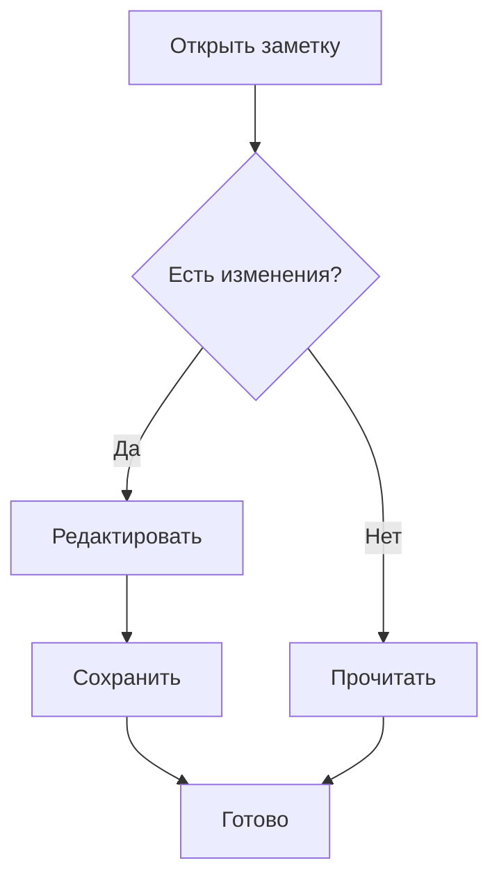
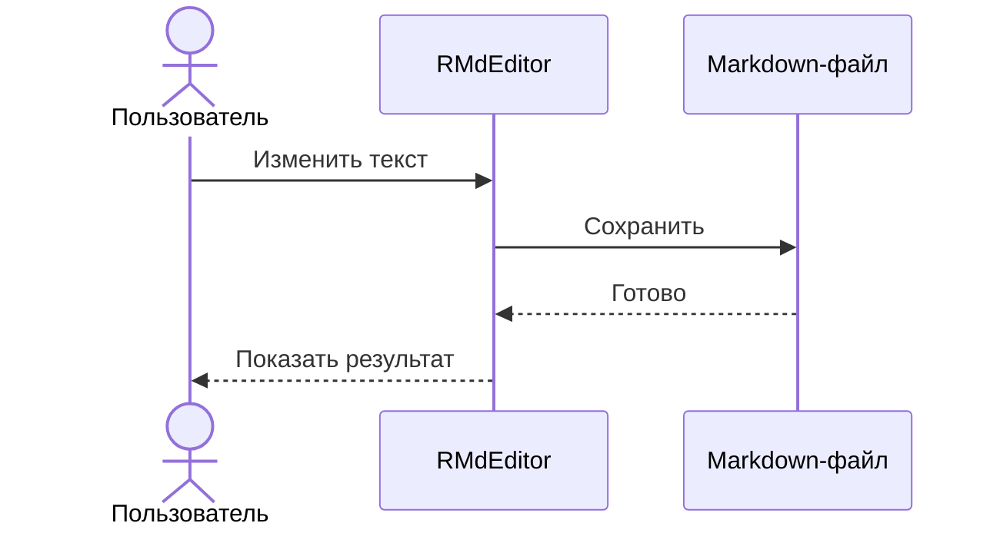
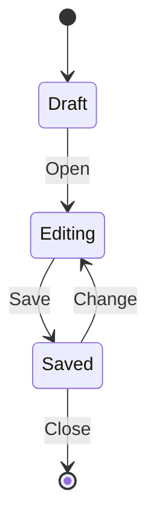

# RMdEditor — площадка для обратной связи

Тема должна оставаться светлой даже при тёмной теме VS Code. Проверьте читаемость текста, выделения, курсора и диаграмм. Поставьте курсор на строку, затем перейдите на другую: маркеры Markdown должны появляться и скрываться.

## Заголовок второго уровня
### Заголовок третьего уровня
#### Заголовок четвёртого уровня
##### Заголовок пятого уровня
###### Заголовок шестого уровня

Обычный текст после заголовков. Достаточно ли различаются их размеры и цвета?

## Выделения и текст

**Жирный текст**, *курсив*, ***жирный курсив***, `inline code` и ~~зачёркнутый текст~~.

Русский текст, English text, числа 1234567890 и символы → ← ✓ ©. Эмодзи: 🎉 📝 🌿.

Это длинный абзац для проверки переноса строк в узком окне. Попробуйте уменьшить ширину редактора, поставить курсор в середину строки, выделить несколько слов, заменить их и отменить изменение. Текст должен оставаться читаемым, а курсор — попадать в ожидаемое место без горизонтальной прокрутки обычного абзаца.

Экранированные символы: \*не курсив\*, \# не заголовок, \[не ссылка\].

## Ссылки

[Пример ссылки](https://example.com) и [ссылка с подписью](https://example.com "Подпись").

Проверьте, удобно ли редактировать адрес. Вне активной строки нажмите ссылку для перехода. Для изменения адреса поставьте курсор на строку стрелками.

## Списки

- Первый пункт
- Второй пункт с **выделением**
  - Вложенный пункт
  - Ещё один вложенный пункт
- Последний пункт

1. Открыть документ
2. Изменить текст
3. Сохранить и открыть заново

Задачи пока представлены исходным Markdown:

- [ ] Проверить ввод
- [x] Открыть пример
- [ ] Написать обратную связь

## Цитаты

> Простая цитата с **важной мыслью**.
> Вторая строка той же цитаты.

Текст между цитатами.

> Внешняя цитата
>
> > Вложенная цитата

## Блоки кода

```typescript
function greet(name: string): string {
  return `Привет, ${name}!`;
}
console.log(greet('RMdEditor'));
```

Код отображается моноширинным блоком. Нажмите «Редактировать», измените код и переведите курсор за пределы блока.

## Mermaid: схема процесса

Нажмите диаграмму для редактирования кода. Затем поставьте курсор на абзац после блока.



Место для курсора вне первой диаграммы.

## Mermaid: взаимодействие



Место для курсора вне второй диаграммы.

## Mermaid: состояния



Место для курсора вне третьей диаграммы. Попробуйте временно испортить код диаграммы, выйти из блока и затем исправить ошибку.

## Таблица и дополнительные конструкции

Таблица отображается визуально; кнопка «Редактировать» открывает Markdown. Картинки, wikilinks и callout пока требуют доработки.

| Возможность | Приоритет | Комментарий |
| --- | --- | --- |
| Таблицы | Высокий | Редактирование ячеек |
| Картинки | Средний | Просмотр внутри текста |
| Wikilinks | Средний | Навигация по заметкам |


[[Заметка]] и [[Заметка|Название ссылки]].

> [!NOTE]
> Obsidian callout пока отображается как обычная цитата.

---

## Проверка сохранения и обратная связь

1. Добавьте сюда пару предложений.
2. Проверьте отмену и повтор изменения.
3. Сохраните через Ctrl+S, закройте и откройте файл.
4. Откройте файл как обычный текст и проверьте сохранённый Markdown.

**Что выглядит хорошо:**

Напишите здесь.

**Что мешает редактировать:**

Напишите здесь: действие, ожидаемый результат и фактический результат.

**Что добавить следующим:**

Напишите здесь.
